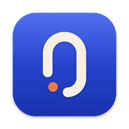
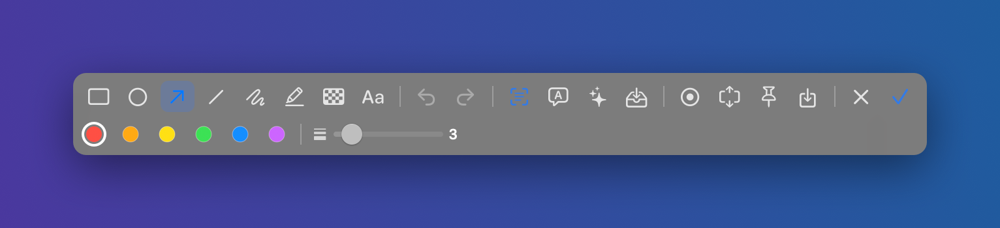
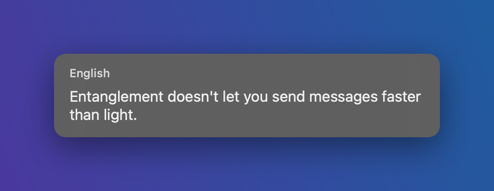
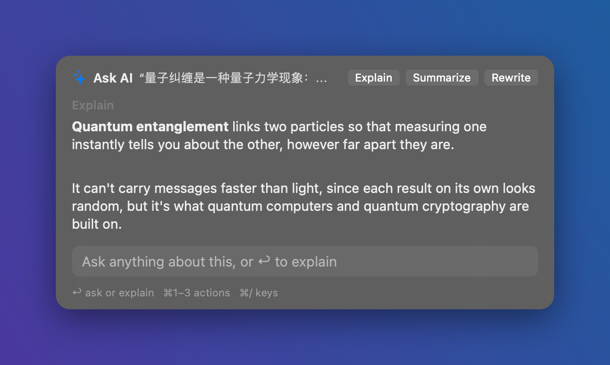
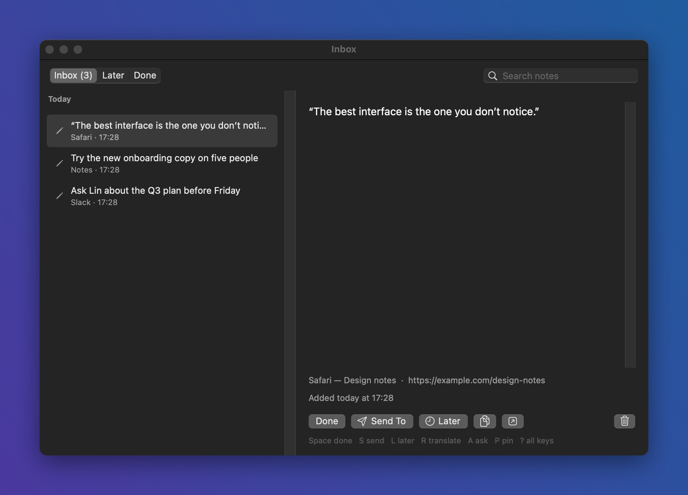
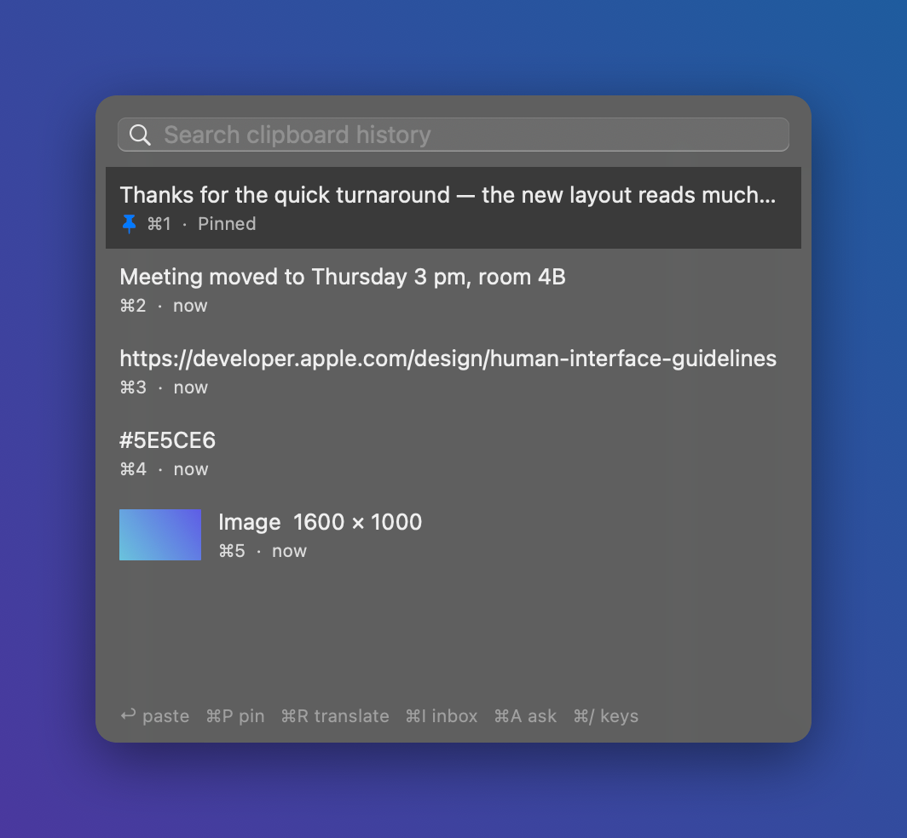
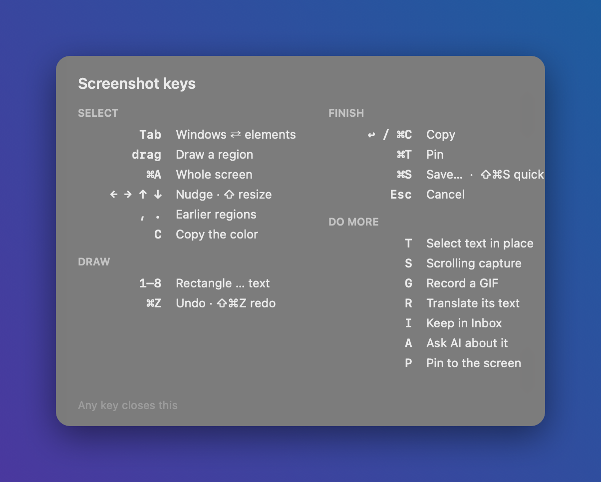

# NyCopilot

### The copilot that lives in every app on your Mac.

Translate what you write and read. Capture and mark up anything on screen. Ask AI about it. 
Keep the thought for later. All of it one keystroke away, right where you're working.

[**Download for macOS**](https://github.com/Nyporte/NyCopilot/releases/latest) · [User guide](docs/GUIDE.md) · [What's new](CHANGELOG.md)

---

## Stop switching apps to get small things done

You're reading a page in another language, and you open a translator. You want to show someone a
detail, and you open a screenshot tool, then an editor, then a chat. You want to know what a
paragraph means, and you open a chatbot and paste it in. You have an idea mid-meeting, and you open
a notes app, and by the time it's open the idea is gone.

**NyCopilot does all of that where you already are.** It sits quietly in your menu bar and wakes up
on a keystroke, over whatever app you're in, then gets out of the way.

- **One keystroke, no detours.** F1 captures, F3 jots a note, ⌥⌘T translates, ⌥⌘A asks AI. Nothing
  to open, nothing to switch to.
- **One capture, many next steps.** Whatever you're looking at, whether a screenshot, a pinned
  image, a clipboard entry or a note, answers the same keys: **R** translates it, **A** asks AI
  about it, **I** keeps it in your Inbox, **P** pins it to the screen.
- **Yours, and private.** No account and no telemetry. Text recognition runs on your Mac, your
  history stays on your Mac, and your keys live in the macOS Keychain.

## Screenshot & Pin: capture anything, then do something with it

Press **F1**. The screen freezes and NyCopilot outlines the window or element under your pointer:
click to take it, or drag any region. Then:

- **Mark it up**: rectangles, ellipses, arrows, lines, pen, highlighter, mosaic, and text, in your colors.
- **Read the text in it**: select and copy text right in the image. The OCR button lights up when
  there's text to find.
- **Go long or go live**: scroll to capture a whole page, or record the region as a GIF.
- **Pin it**: keep the image floating above everything while you work, zoom it, make it click-through.
- **Hand it on**: copy, save, translate the text in it, ask AI about it, or drop it in your Inbox.

The app you were in never flickers or loses its place. When you're done, you're right back where you were.

## Translate: write in any language, read everything in yours

- **Translate as you type.** Press ⌥⌘T in any text field, type in your language, press Return:
  the field gets the translation. Tab switches between your favorite target languages.
- **Translate a selection.** Select text on a page, in a PDF or a message, tap ⌥⌘T, and the
  translation appears on a card right beside it.
- **Translate the whole screen.** Hold ⌥⌘T and every block of text on screen lights up. Point at
  one to read it in your language.

Works with macOS's own on-device translation out of the box, or with Google Translate, Volcengine,
or any AI model you connect, which can follow your style instructions ("formal Japanese", anyone?).

 

## Ask AI: explain, summarize, rewrite, right where you read

Select a paragraph, a word or a screenshot and press **⌥⌘A** (or **A** on a capture). Explain,
Summarize and Rewrite are one click away; anything else, just ask, and keep the conversation going.
Answers stream in as they're written, in your language, and a rewrite can replace your selection
in place.

**Bring your own model.** NyCopilot works with any OpenAI-compatible endpoint: a hosted provider,
or a model running on your own Mac with Ollama or LM Studio, fully offline.

## Inbox: catch the thought, deal with it later

Press **F3** to jot a thought in a one-line bar that disappears as soon as you press Return. Or
select text in any app and press F3 to keep it, along with where it came from. Screenshots go in
with **I**.

Later, work through it with the keyboard: **Space** marks done, **L** snoozes it until tonight or
next week, and **S** sends it to Reminders, Apple Notes, or a Markdown folder (an Obsidian vault
works beautifully).

## Clipboard: everything you copied, one keystroke back

Press **⌥⌘V** to see everything you've copied, text and images, newest first. Type to search,
press Return to paste it into the app you were in, or **⌘1–9** for the first nine. Pin the ones you
reuse every day.

Passwords and anything apps mark as private are never kept. Copies from password managers are
skipped too.

 

## Window Layouts: halves, thirds, corners, one shortcut each

Snap the front window to a half, a third, two thirds, a corner, or the next display with a
shortcut, or drag it to a screen edge. Coming from Rectangle? Import your shortcuts in one click.

## Every key, one press away

You don't need to memorize anything. Press **?** in any NyCopilot panel to see its keys, or
**⌥⌘/** for every shortcut you've set. Tips show up a couple of times, at the moment they help,
then never again.

## Speaks your language

NyCopilot's interface is in **English, 简体中文, 繁體中文, 日本語, 한국어, Español, Français,
Deutsch, Português (Brasil), and Русский**. It follows your Mac, or pick one in Settings → General.

## Private by design

- **No account, no telemetry, no analytics.** NyCopilot doesn't phone home.
- **On your Mac.** Text recognition uses macOS Live Text, on device. Clipboard history, notes,
  screenshots and translation history stay in a private folder in your Library.
- **Only what you send, only where you send it.** Text goes to a translation service or AI model
  only when you ask, and only to the ones you set up. A screenshot goes to a model only when you
  press A on it.
- **Keys in the Keychain.** API keys are stored in the macOS Keychain and never written anywhere else.

## Get started

1. **[Download the latest release](https://github.com/Nyporte/NyCopilot/releases/latest)**,
   unzip it, and move **NyCopilot** to Applications. It's signed and notarized by Apple.
2. **Open it.** A short guide asks what you want help with and sets up the shortcuts: F-keys or
   ⌥⌘ letters, whichever suits your keyboard.
3. **Allow Accessibility** when asked, so NyCopilot can read selections and paste results. The first
   capture asks for Screen Recording.

Everything else is optional. Translation works through macOS right away; connect an AI model in
Settings → AI & Engines whenever you like.

**Requirements:** macOS 14 Sonoma or later, on a Mac with Apple silicon.

## Questions

**Is it free?** Yes, free and open source under the MIT license. If you use an AI provider, you pay
them directly, or run a local model for free.

**Do I need an AI subscription?** No. Screenshots, the Inbox, clipboard history, window layouts and
on-device translation all work without one. AI adds Ask AI, screen translation, and translations
that follow your instructions.

**Will it slow my Mac down?** NyCopilot is a native app with a Rust core, idle in the menu bar
until you press a key.

**I found a bug, or I have an idea.** Choose **Send Feedback…** in the NyCopilot menu, or
[open an issue](https://github.com/Nyporte/NyCopilot/issues/new/choose). Bug reports come with
Diagnostics: what the app did lately, never your text.

## Under the hood

NyCopilot is a native Swift/AppKit app on a shared Rust core that owns data, settings and model
access, built so more platforms can follow. Want to build it, read the architecture, or contribute?

- [Build from source and how it's made](docs/GUIDE.md#how-its-built)
- [Contributing: branches, commits, checks, and releases](CONTRIBUTING.md)
- [Architecture](spec/architecture.md) · [Protocol](spec/protocol.md) · [Modules](spec/modules.md)

## License

[MIT](LICENSE) © Nyporte
